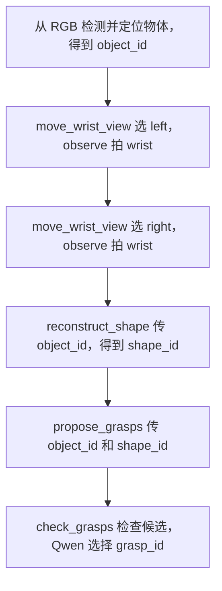
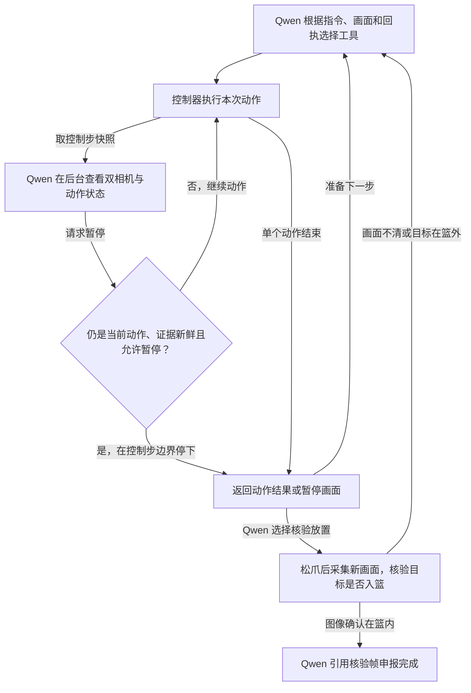

# Qwen 工具调用与 LIBERO-Object 评测

Qwen3.5-4B 接收任务指令、初始全局 RGB 图、工具定义和历史回执，每轮选择一个工具和参数。项目的 Harness 按工具定义检查参数和证据编号，再调用对应函数。CaPtain 提供模型通信客户端和 LIBERO 后端适配。后端通过 OSC 控制仿真的 Franka。 [模型循环](../libero_adapter/tool_agent/agent.py) · [工具注册和回执](../libero_adapter/tool_agent/session.py)

## 工具清单

Qwen 自己选择每一轮调用什么、用哪张图、采用哪个候选，以及出错后是否换角度或改抓法。提示词提供常见选择，实际顺序由模型结合任务和回执决定。分割、深度、主动补拍、负载估算、诊断和记忆由 Qwen 按需调用。Harness 校验编号与前提，例如同一物体的重量估计与抓取候选才能配对，提交入篮成功要给出松爪后的新证据。

### 观测与几何

| 工具 | 什么时候用 | 输入和回执 |
| --- | --- | --- |
| `observe` | 需要新画面，或动作后场景变了。 | 传 `camera`，可选 `overview`、`wrist`、`both`。返回所选 RGB 图、`frame_id` 和仿真步。 |
| `detect_object` | 先找出指令中物体的大概图像位置。 | 传 `frame_id` 和 `target`。得到框、标注图和 `detection_id`。 |
| `segment_object` | 目标与邻居接近，或需要挑出目标区域的深度像素。 | 传 `detection_id`。得到掩膜、叠加图和 `mask_id`。 |
| `estimate_depth` | 需要补充目标距离证据。 | 传 `frame_id` 和深度图对应的 `camera`。从 RGB 三角测量，返回 `depth_id`、有效表面样本数和预览图。 |
| `locate_object` | 把画面中的目标换算成机器人底座坐标。 | 传 `detection_id`，可加同帧的 `mask_id` 和 `depth_id`。得到 `object_id`、估计位置、尺寸与来源。 |
| `locate_basket` | 需要给抓取计划添加篮筐目标。 | 传 `frame_id`。得到篮筐估计位置和 `destination_id`。 |
| `move_wrist_view` | 单张图看不清形状，想用腕部补拍另一个角度。 | 传 `view`，可选 `left`、`right`、`center`。可指定 `object_id`，默认采用当前目标的最近有效定位。返回到位状态，之后独立调用 `observe` 拍照。 |
| `reconstruct_shape` | 有不同角度的腕部 RGB，希望用局部三维表面来选抓法。 | 只传 `object_id`。工具选用本物体每个已拍角度的最近有效帧。返回 `shape_id`、参与帧编号、点云质量、可见范围和预览图。 |
| `find_ridge` | 需要寻找牛奶盒等纸盒的顶脊方向或跨脊候选。 | 传 `object_id`。用 OpenCV 线段检测、相机标定和标称屋脊高度估计位置与方向，返回屋脊候选和标注图，证据不足时给出不确定状态。 |

### 抓取候选与执行

| 工具 | 什么时候用 | 输入和回执 |
| --- | --- | --- |
| `get_gripper_spec` | 想知道两指能张多宽、接触面的大小和工具坐标系。 | 无参数。返回本项目 Panda 夹爪的几何参数。 |
| `propose_grasps` | 需要对比不同高度、接近方向或闭合方向。 | 传 `object_id`，可加 `shape_id`。返回候选 `grasp_id`、位置、姿态、接触点估计和推荐依据。 |
| `check_grasps` | 选定抓法前，需检查开口、间隙、工作空间及端点可达性。 | 传 `object_id`。返回各候选的通过状态、理由和可用的端点 IK 结果。 |
| `estimate_weight` | 想区分空包装和可能装有内容物时的负载。 | 传 `object_id`。得到 `load_id`、公斤区间、尺寸来源、密度和填充假设，证据不足时得到未知状态。 |
| `estimate_grip_force` | 想估算选定夹法在竖直抬举时所需的夹紧力。 | 传 `grasp_id` 和同一物体的 `load_id`。得到 `force_estimate_id`、每指法向力和双指总和的牛顿区间，以及摩擦假设。 |
| `plan_motion` | Qwen 已选好要尝试的抓取候选。 | 传 `grasp_id`，可加 `destination_id`。得到 `plan_id` 和可独立执行的路点，准备计划时机械臂保持静止。 |
| `move_arm` | 要执行计划中的一个路点。 | 传 `plan_id` 和 `waypoint`，如 `pick_hover`、`grasp`、`lift` 或 `basket`。返回到位状态和执行回执。 |
| `set_gripper` | 到抓取处后闭爪，或决定放下、松开。 | 传 `state=open` 或 `state=close`。返回开闭执行回执。篮筐上方有效松爪会记录关联的计划。 |
| `test_lift` | 闭爪后想先小幅抬升，便于观察新抓法是否夹住。 | 传 `plan_id`。保持夹爪姿态，目标向上移动 4 厘米。返回动作结果，抓持证据由 `check_grip` 提供。 |
| `retreat_arm` | 开爪状态下回退，清除视野遮挡或准备重试。 | 无参数。尝试抬高空夹爪，返回目标高度和结果。 |

### 抓持、恢复与完成

| 工具 | 什么时候用 | 输入和回执 |
| --- | --- | --- |
| `get_gripper_state` | 需要查看夹爪的当前开度或开闭命令记录。 | 无参数。返回开度比例、夹紧计划和篮筐松爪计划的编号。 |
| `check_grip` | 闭爪或抬升后，要核对目标是否留在两指间。 | 传 `plan_id`，可引用新采集的 `frame_id`。用夹爪开度和视觉线索返回抓持证据及建议。 |
| `diagnose_drop` | 发现没拿起来、疑似中途滑落，或需要决定怎样重试。 | 传 `plan_id`，可引用 `frame_id`。返回 `diagnosis_id`、证据支持的阶段或可能原因、不确定性和可选下一步。 |
| `remember_attempt` | 想记下这次已执行的抓法，给本局重试参考。 | 传 `plan_id`，可加同一次尝试的 `diagnosis_id` 和 `verification_frame_id`。返回 `memory_id` 和记录阶段，证据变化时更新修订。 |
| `recall_attempts` | 想比较之前尝试过的抓法、卡住的位置和结果。 | 传任务中的 `target`。返回本局最近保存的最多五次尝试，包括抓取策略、位姿、动作回执和已关联的诊断或核验。 |
| `inspect_place` | 松爪后给放置结果收集新画面。 | 传 `camera`。返回新 RGB、`frame_id` 和本次篮筐松爪的证据关联。 |
| `verify_place` | 要确认物体是否留在篮筐内。 | 传 `inspect_place` 的 `frame_id` 和 `target`。输出篮内、篮外或证据不足。 |
| `finish_task` | 需要向 Harness 提交完成或说明受阻。 | 传 `outcome`、`frame_id`、`reason`。入篮结论要引用本次松爪后的最新核验帧。 |

抓取路点执行失败时，回执会保留请求位置、可用的位置残差以及下一步选项。Qwen 可以退开夹爪、重新观察、更新候选。官方成功由 LIBERO 在回合结束后独立判定。 [动作与回执](../libero_adapter/tool_agent/session.py) · [视觉核验](../libero_adapter/tool_agent/verify.py)

## 负载、夹持证据和重试记录

- `estimate_weight` 根据 RGB 识别类别、声明尺寸、空包装质量和填充假设给出不同情形。画面中的同一个牛奶盒可以对应空盒和装有液体两种情况，真实质量需测量。区间会随尺寸、容器材质和填充假设变化。 [负载估算](../libero_adapter/tool_agent/load.py)
- `estimate_grip_force` 按两个相对指垫均分负载的情形计算每指法向力，公式为 `安全系数 × 质量 ×（重力加速度 + 抬升加速度）÷（2 × 静摩擦系数）`。默认用 0.2–0.6 的摩擦系数、0–0.5 m/s² 的向上加速度和 1.5 的安全系数，结果描述给定假设下的防滑需求。偏心、材料压坏和实际摩擦仍需要实测。LIBERO 动作接口执行开闭，回执中的夹持力测量和力设定点均标为不可用。 [力估算代码](../libero_adapter/tool_agent/load.py) · [Modern Robotics 摩擦模型](https://modernrobotics.northwestern.edu/nu-gm-book-resource/12-2-1-friction/)
- `check_grip` 同时参考闭爪回执、开度和腕部画面。被夹物体在抬升后留下开度和视觉迹象，可返回 `gripped`。只有部分信号时给出 `possible_grip` 或 `uncertain`，也可返回 `empty` 或 `no_active_grasp`。腕部前景说明两指附近有物体，目标身份仍由任务和视觉核验另行判断。 [抓持核验](../libero_adapter/tool_agent/retention.py)
- `diagnose_drop` 按下探、闭爪、抬升、搬运和松爪阶段对照证据。例如闭爪后开度一直处于空夹范围，支持抓空。闭爪保持期间开度从受阻变为空夹，支持抬升或搬运中失去抓持。控制器未到位时，诊断保留路点失败，并将遮挡或阻滞作为待核原因。证据不足可补拍后再改抓法。 [掉落诊断](../libero_adapter/tool_agent/retention.py)
- 记忆写入当前回合的 `attempt_memory.jsonl`。同一计划有后续证据时可修订，重复内容复用原记录。每局独立保存，评测回合之间相互隔离。 [尝试记忆](../libero_adapter/tool_agent/memory.py)

## 主动多视角与抓取

下图是一条可选调用路径。Qwen 根据画面和回执决定是否补拍、走屋脊分支或继续规划。逐局实际调用以 `events.jsonl` 为准。



- 用 `reconstruct_shape(object_id)` 重建。工具至少需要两个不同腕部角度。需要第三个角度时，用 `move_wrist_view` 选择 `center` 并再次拍腕部 RGB，工具会一起使用。每个角度保留最近有效帧，参与重建的 `frame_ids` 写入回执和日志。扫描需要夹爪张开并且物体保持静止。
- 点云来自 RGB 特征匹配和标定三角测量，覆盖可见纹理和轮廓附近的匹配点。可见范围只表示局部证据。纹理少或遮挡严重时，有效点会不足，可增加角度或让候选生成使用 LIBERO 物体的标称几何。仿真相机深度关闭。 [重建代码](../libero_adapter/tool_agent/shape.py) · [RGB 深度代码](../libero_adapter/tool_agent/depth.py)
- `propose_grasps` 区分两侧都有观测支持的候选和由局部表面推断的候选。夹爪模型给出 79 毫米最大垫片间距、75 毫米建议抓取宽度和 16×16 毫米指垫接触面。指垫中心到手指根部约 41 毫米，用于估算局部伸入余量。实际可伸入深度还由物体形状、周边间隙和接近方式决定。筛选通过的候选仍需要动作回执和后续放置核验。 [位姿生成与检查](../libero_adapter/tool_agent/grasp.py) · [夹爪参数](../libero_adapter/tool_agent/gripper_spec.json)

## 动作中看图与结束判定



- 单局 `agent` 和批量 `evaluate` 均支持可选的 `--live-monitor`。启用后，控制程序按 20 Hz 节拍执行动作，每 10 个控制步尝试收集同步全局 RGB、腕部 RGB 和状态。Qwen 的独立审查线程调用 `review_motion(decision, reason)`，可建议 `continue` 或请求 `cancel`。同一时刻至多一个审查请求在途，控制步继续执行，完整记录写入 `live_monitor.jsonl`。每局结果和批次清单记录 `live_monitor` 开关，可区分监看是否参与。 [监看代码](../libero_adapter/tool_agent/live_monitor.py) · [动作节拍](../libero_adapter/tool_agent/live_motion.py)
- 停止请求需在动作仍有效、快照未超时且当前阶段允许中断时，才会在仿真控制步边界生效。开爪接近、下探、回退和腕部换角，以及已持物时的试抬、抬升或搬运按各自条件判断。停下后 Harness 回传两路 RGB 和 `interruption_frame_id`，由 Qwen 选择后续工具。 [停止接线](../libero_adapter/tool_agent/session.py) · [ROS 2 Actions](https://design.ros2.org/articles/actions.html)
- 经过篮筐上方松爪后，任务用 `inspect_place` 采集专门的新画面，再以 `verify_place` 核验。监看回执只评价运动片段，最终报告记录视觉核验和回合结束后的 LIBERO 官方判分。 [相机核验](../libero_adapter/tool_agent/verify.py) · [评分入口](../libero_adapter/tool_agent/agent.py)

## 运行和查看评测

在项目根目录运行。以下命令使用本机已准备的 LIBERO 环境和已下载的 `qwen3.5:4b`，模型端点默认是本机 Ollama。完整范围为 10 道官方任务，每题 50 个官方初始状态。

```bash
../benchmarks/.venv-libero/bin/python -m libero_adapter.tool_agent.evaluate \
  --libero ../benchmarks/LIBERO --output runs/libero-tool-agent-full --workers 4

python3 -m libero_adapter.tool_agent.report runs/libero-tool-agent-full --select-replays
```

为选出的题号和初始状态补录时，用 `--tasks` 和 `--seeds` 指定范围，并加上 `--record-replay`。下面以第 7 题和状态 0 为例。也可以在完整评测开始时加 `--record-replay` 为每局直接保存 GIF。

```bash
../benchmarks/.venv-libero/bin/python -m libero_adapter.tool_agent.evaluate \
  --libero ../benchmarks/LIBERO --output runs/libero-tool-agent-milk-replay \
  --tasks 7 --seeds 0 --workers 1 --record-replay

python3 -m libero_adapter.tool_agent.report runs/libero-tool-agent-full \
  --replays runs/libero-tool-agent-milk-replay
```

重复 `--replays` 可加载其他回放目录。报告按各补录回合的实际判分归类 GIF。主评测成绩保存在 `summary.json` 和 `trials.csv`，成功率的分母是官方已判分的回合数。基础设施错误单独统计。用相同目录和配置可继续未完成评测。源码、场景或模型版本改变时用新目录。

`report.html` 内嵌成功与失败的双视角 GIF，也可阅读 `report.md`。牛奶盒的 `milk-flow.svg` 按原日志从上到下呈现调用。用 `--milk` 可明确选定牛奶盒回合目录。每局目录保存 `tools.json`、`events.jsonl`、`model.jsonl` 和 `result.json`。一次回放实际用过的估算、诊断、记忆调用可在该局日志中核对。 [评测入口](../libero_adapter/tool_agent/evaluate.py) · [报告入口](../libero_adapter/tool_agent/report.py)

## 参考

- 《Agent as Policy for Robotic Manipulation》用动作后的新证据驱动执行与恢复。这里将同类反馈用于独立工具调用、失败后的重新观察和放置复核。 [论文](https://arxiv.org/abs/2609.12541)
- LIBERO 提供任务、初始状态和官方判分。 [论文](https://arxiv.org/abs/2306.03310) · [项目](https://libero-project.github.io)
- OpenCV 的概率霍夫变换和三角测量对应当前屋脊候选和 RGB 三维点计算。 [霍夫线段检测](https://github.com/opencv/opencv/blob/4.x/doc/tutorials/imgproc/imgtrans/hough_lines/hough_lines.markdown) · [三角测量接口](https://github.com/opencv/opencv/blob/4.x/modules/calib3d/include/opencv2/calib3d.hpp)
- MoveIt Task Constructor 的阶段式抓放和 Contact-GraspNet 的点云抓取是可对照的方案。 [MoveIt Task Constructor](https://moveit.picknik.ai/main/doc/tutorials/pick_and_place_with_moveit_task_constructor/pick_and_place_with_moveit_task_constructor.html) · [Contact-GraspNet 论文](https://arxiv.org/abs/2103.14127)
- 主动视角抓取研究用腕部深度相机选择下一观测位置。本项目用标定后的腕部 RGB 补拍，并把可见点的范围与匹配质量交给 Qwen。 [Closed-Loop Next-Best-View Planning](https://arxiv.org/abs/2207.10543)
- GelSight 用局部接触形变区分滑移和整体运动。真实 Franka 的 `grasp` 接口可设置目标宽度、速度与夹持力，设备状态回报开口与抓持状态。当前 LIBERO 的开度和腕部图像用于标记抓空、掉落或证据不足。 [GelSight 研究](https://arxiv.org/abs/1708.00922) · [Franka 官方夹爪接口](https://github.com/frankarobotics/libfranka/blob/main/include/franka/gripper.h)
