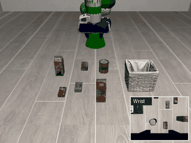

# LIBERO-Object 评测结果 · 2026-11-26

**新版官方判定通过 496/500 局（99.2%）**。旧版在同一组 500 个题目与初始状态组合上通过 293/500 局（58.6%）。此次 500 局均有官方判定，4 局失败，运行故障为 0。

Qwen 根据松爪后的新画面确认 **469 局**入篮。另有 27 局官方通过、视觉未确认。Qwen 误报成功 0 局。

## 逐题成绩和双视角回放

| 题号 | 抓取目标 | 官方成功 | 旧版官方成功 | Qwen 视觉确认 | 成功回放 | 失败回放 |
| ---: | --- | ---: | ---: | ---: | --- | --- |
| 0 | 字母汤罐 | 50/50 | 50/50 | 48/50 | [状态 0](replays/task_00/success/state_00/pick-place.gif) | — |
| 1 | 奶油奶酪 | 48/50 | 46/50 | 27/50 | [状态 0](replays/task_01/success/state_00/pick-place.gif) | [状态 1](replays/task_01/failure/state_01/pick-place.gif)、[状态 49](replays/task_01/failure/state_49/pick-place.gif) |
| 2 | 沙拉酱 | 50/50 | 0/50 | 50/50 | [状态 0](replays/task_02/success/state_00/pick-place.gif) | — |
| 3 | 烧烤酱 | 49/50 | 50/50 | 49/50 | [状态 1](replays/task_03/success/state_01/pick-place.gif) | [初始双视角](replays/task_03/failure/state_00/pick-place.gif) |
| 4 | 番茄酱瓶 | 50/50 | 0/50 | 50/50 | [状态 0](replays/task_04/success/state_00/pick-place.gif) | — |
| 5 | 番茄酱罐 | 50/50 | 50/50 | 48/50 | [状态 0](replays/task_05/success/state_00/pick-place.gif) | — |
| 6 | 黄油 | 49/50 | 47/50 | 49/50 | [状态 0](replays/task_06/success/state_00/pick-place.gif) | [状态 8](replays/task_06/failure/state_08/pick-place.gif) |
| 7 | 牛奶盒 | 50/50 | 0/50 | 50/50 | [状态 0](replays/task_07/success/state_00/pick-place.gif) | — |
| 8 | 巧克力布丁 | 50/50 | 50/50 | 50/50 | [状态 0](replays/task_08/success/state_00/pick-place.gif) | — |
| 9 | 橙汁盒 | 50/50 | 0/50 | 48/50 | [状态 0](replays/task_09/success/state_00/pick-place.gif) | — |

每题用 50 个固定初始状态评测。回放按照原回合保存的 Qwen 调用补录，并按原控制步数和官方判定核对。上传版保留回放总时长与首尾帧，缩减分辨率和中间帧。主画面为固定相机，右下角为腕部相机。烧烤酱失败局因模型反复引用无效帧号而没有运动，回放保留初始画面。 [四局失败的工具记录](audit.md#失败和常见拒绝)

## 评测方法

- 使用 Qwen3.5-4B（Ollama 标签为 `qwen3.5:4b`）、LIBERO-Object 的 10 个官方任务和每题 50 个初始状态。仿真控制以 20 Hz 为目标频率，每局上限为 280 个控制步和 44 轮工具选择。
- Qwen 从 27 个独立工具中选择当前调用。每局结束后由 LIBERO 单独给出官方判定。Qwen 申报成功要引用松爪后的新相机画面和入篮核验结果。
- 完整批次启用动作中的异步双相机监看，使用 6 个并发进程。3,319 次监看请求中有 1 次及时返回，决定继续动作。另一次独立模拟验收以 10 Hz 墙钟步频运行。Qwen 根据图像发出暂停，控制器在第 13 个控制步停下，夹爪目标保持原状态。 [独立暂停记录](evidence/live-pause.json)

## 牛奶盒原始回合

第 7 题初始状态 0 通过官方判定及 Qwen 的相机核验。Qwen 发出 38 次工具调用，从中间和左侧两张腕部图像三角测量得到 38 个可见表面点，并比较了 8 个候选。它选中较高的盒身抓法，在试抬后检查抓持状态，再搬运、松爪并核实入篮。 [真实调用流程](evidence/milk-flow.svg) · [点云与抓取候选](evidence/milk-grasp-geometry.png) · [工具记录](evidence/milk-events.jsonl)



## 数据与复现

准备好 LIBERO 环境并启动本机 Ollama 后，在仓库根目录运行完整评测。

```bash
OMP_NUM_THREADS=1 OPENBLAS_NUM_THREADS=1 LP_NUM_THREADS=2 \
  ../benchmarks/.venv-libero/bin/python -m libero_adapter.tool_agent.evaluate \
  --libero ../benchmarks/LIBERO --output runs/libero-object-qwen-live-full \
  --workers 6 --live-monitor
```

| 文件 | 内容 |
| --- | --- |
| [逐局成绩](trials.csv) | 500 个回合的官方判定、同状态旧版判定、Qwen 视觉确认、动作步数和失败原因 |
| [评测汇总](summary.json) | 原始汇总与各题统计 |
| [评测审计](audit.md) · [结构化审计](audit.json) | 判定对照、工具调用、恢复、监看与失败分类 |
| [运行清单](manifest.json) | 去除本机路径与地址后的评测设置、运行版本、场景、模型和源码摘要 |
| [工具定义](tools.json) · [运行说明](../../docs/tool_agent.md) | 本次给 Qwen 的工具定义与运行入口 |
